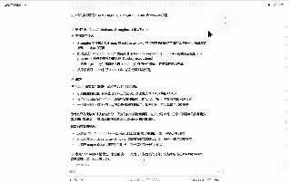
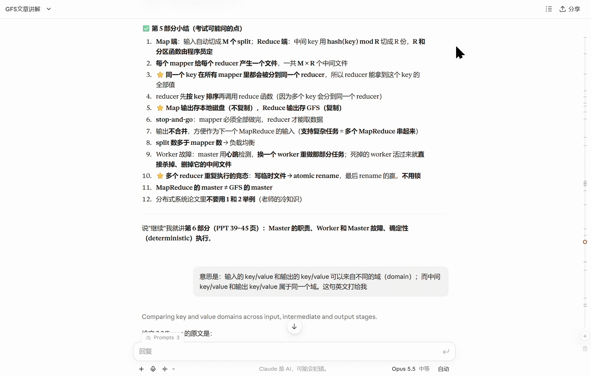
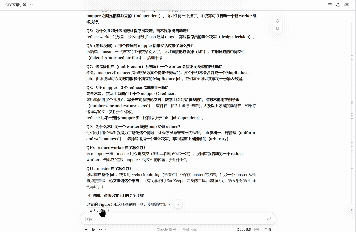
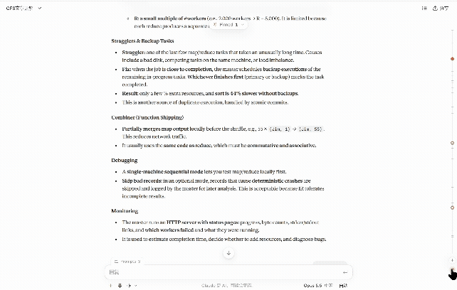

# Claude Navigator

A userscript for [claude.ai](https://claude.ai) that makes long conversations easy to find your way around.


## Features

- **Pin key answers.** Pin the answers that matter and keep them open in a floating panel, so you can check back on them anytime — even while reading somewhere else in the conversation. Click a pin to jump straight to it.

  

- **Mark and preview.** Mark any answer and it shows up on the side rail. Hover a mark to preview its summary, click to jump straight there.

  

- **Saved prompts.** Keep phrases you type often beside the message box and insert them at the cursor with one click.

  

- **Clear in one click.** Wipe every pin and mark off the page with a single button.

  

- Light and dark themes that follow Claude.

## Install

1. Install [Tampermonkey](https://www.tampermonkey.net/).
2. In Chrome or Edge, open `chrome://extensions`, open Tampermonkey's **Details** and turn on **Allow User Scripts**.
3. Open the install link: **[claude-navigator.user.js](https://raw.githubusercontent.com/Cannizzaro-reaction/claude-navigator/main/dist/claude-navigator.user.js)**. Tampermonkey shows an install page; click **Install**.
4. Open a conversation on claude.ai and reload.

Tampermonkey checks the same link for updates.

## Project Structure

No dependencies. You need Node.js 18 or newer.

```
src/
  meta.txt          userscript header (version and links are filled in from package.json)
  styles.css        all styles
  config.js         selectors and defaults: update these when Claude changes its page
  utils.js          icons and small helpers
  titles.js         automatic titles
  ui.js             page elements, shared state, toasts, theme
  conversation.js   finding messages and loading the full conversation
  store.js          saved pins and marks
  panel.js          the Pinned panel and the rail menu
  rail.js           the side rail, layout, clear-all and jumping
  hover.js          pin and mark buttons beside each message
  prompts.js        saved prompts
  main.js           refresh loop, diagnostics, start-up
dist/
  claude-navigator.user.js   built file, committed so the install link works
```

## Disclaimer

Not affiliated with or endorsed by Anthropic. Claude is a trademark of Anthropic.

## License

[MIT](LICENSE)
